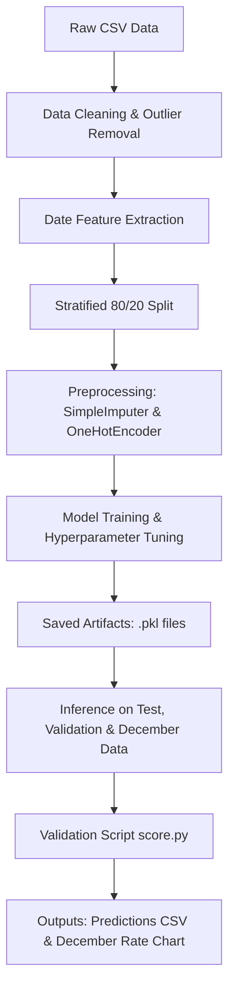

# Freight Rate Machine Learning End-to-End Project

An end-to-end machine learning system designed to predict freight shipping rates based on shipment attributes, geographic coordinates, and temporal features.

## Project Overview

In the freight and logistics industry, spot prices (the cost to ship freight on short notice) fluctuate continuously based on distance, cargo weight, equipment type, season, and location. Estimating these rates accurately is critical for freight brokers, shippers, and carriers to price shipments competitively and manage transportation costs effectively.

This project implements an end-to-end data science pipeline that cleans historical shipment records, transforms geographic and date attributes, trains multiple regression models, and predicts freight rates (`posted_rate`) for new loads. For example, given a 360-mile shipment using a Dry Van trailer carrying 32,000 lbs, the trained model estimates the expected freight rate in dollars.

**Current Status:** Working machine learning application and assessment project.

---

## What the Project Does

- **Data Cleaning and Preprocessing:** Identifies and handles missing values using numerical median imputation (`SimpleImputer`), converts date columns into calendar sub-features, and applies one-hot encoding (`OneHotEncoder`) to categorical equipment types.
- **Outlier Removal:** Filters out corrupt data points, such as records with negative cargo weight values.
- **Stratified Dataset Splitting:** Uses `StratifiedShuffleSplit` on distance brackets (`distance_cat`) to maintain representative distance distributions across training (80%) and testing (20%) datasets.
- **Multi-Model Evaluation & Tuning:** Trains and evaluates Random Forest, LightGBM, and XGBoost regressors using 5-fold cross-validation and `RandomizedSearchCV` hyperparameter optimization.
- **Model Checkpointing:** Exports fitted preprocessing transformers (`imputer.pkl`, `onehot_encoder.pkl`) and the top-performing model artifact (`best_xgboost_model.pkl`) for repeatable inference.
- **Multi-Stage Inference:**
  - **Stage 1 (Train-Test):** Evaluates test performance on an untouched 20% holdout set and saves predictions with error analysis (`Test xgboost_predictions_LoadedMODEL.csv`).
  - **Stage 2 (Validation):** Generates predictions for an unlabelled validation dataset (`validation_predictions.csv`).
  - **Stage 3 (December Scenario):** Predicts daily rate changes across December 2025 for a fixed corridor and plots a trend chart (`scorer_results/candidate_december.png`).

### Expected Inputs and Outputs

- **Input Data:** Raw CSV files (`train-test-exp.csv`, `validation.csv`, `december_chart_inputs.csv`) containing shipment attributes:
  - `load_id`: Unique load identifier (e.g., `TR-000007`, `TE-000001`).
  - `pickup`, `delivery`: City names (dropped during feature engineering in favor of spatial coordinates).
  - `pickup_lat`, `pickup_lon`, `delivery_lat`, `delivery_lon`: Origin and destination coordinates.
  - `distance`: Route distance in miles.
  - `equipment`: Trailer type (e.g., `Dry Van`, `Reefer`, `Flatbed`).
  - `weight`: Shipment weight in pounds.
  - `date`: Shipment date.
  - `posted_rate`: Target freight rate in dollars (present in training data).

- **Output Data:**
  - `validation_predictions.csv`: Model predictions formatted as `load_id,predicted_rate`.
  - `xgboost_test_metrics.csv`: Final evaluation metrics on the holdout test set.
  - `scorer_results/candidate_december.png`: Generated chart visualizing predicted December freight rates over time.

---

## How It Works

1. **Data Exploration & Cleaning:** Raw data is loaded from `data/train-test-exp.csv`. Invalid records with negative weights are dropped. The `date` field is parsed into numerical features: `month`, `day`, `weekday`, `week_of_year`, and `day_of_year`.
2. **Stratified Splitting:** A helper attribute `distance_cat` is created to perform an 80/20 train/test split that preserves distance distributions.
3. **Preprocessing Pipeline:**
   - Numerical missing values are filled using `SimpleImputer(strategy="median")`.
   - Categorical equipment types are converted to binary vectors using `OneHotEncoder`.
   - City names are dropped because latitude and longitude coordinates capture spatial relationship patterns without being tied to specific city names.
4. **Model Training & Comparison:** Baseline and hyperparameter-tuned models (Random Forest, LightGBM, and XGBoost) are trained using cross-validation. XGBoost achieves the best performance.
5. **Inference & Scoring:** Saved artifacts are loaded to score validation and December scenario datasets. The `score.py` script validates the output formats and plots rate trends.



### Key Technologies

- **Python 3.13:** Runtime environment.
- **`uv`:** Fast Python package and environment manager.
- **Pandas & NumPy:** Data manipulation, cleaning, and matrix operations.
- **Scikit-Learn:** Data preprocessing pipelines (`SimpleImputer`, `OneHotEncoder`), stratified splitting, and baseline regression models.
- **XGBoost & LightGBM:** Gradient-boosted decision tree frameworks optimized for tabular regression problems.
- **Matplotlib:** Plotting utility used by `score.py` to generate the December rate forecast chart.
- **JupyterLab:** Interactive notebook environment used for pipeline execution.

---

## How to Access or Try It

*Note: There is no live web demo or external deployment URL for this project. It runs locally using Python and JupyterLab.*

### Prerequisites

- Python 3.13 or higher.
- `uv` package manager (recommended) or standard `pip`.

### Setup Instructions

1. **Clone or navigate to the repository directory:**
   ```bash
   cd freight-rate
   ```

2. **Install dependencies:**
   Using `uv` (recommended):
   ```bash
   uv sync
   ```
   Or using standard `pip`:
   ```bash
   pip install jupyterlab pandas numpy matplotlib scikit-learn xgboost lightgbm joblib
   ```

### Execution Commands

- **To run the complete training pipeline interactively:**
  Launch JupyterLab:
  ```bash
  uv run jupyter lab
  ```
  Open and execute the notebooks in order:
  1. `main train test.ipynb`: Runs data exploration, preprocessing, model training, evaluation, and saves `.pkl` artifacts.
  2. `validation unknown.ipynb`: Loads saved `.pkl` artifacts and generates `validation_predictions.csv`.
  3. `december_Model_code.ipynb`: Generates December predictions for the evaluation chart.

- **To run the validation and scoring script directly:**
  Execute `score.py` using `uv`:
  ```bash
  uv run python score.py --predictions validation_predictions.csv --december-predictions data/december_chart_inputs.csv
  ```

  **Expected Output upon success:**
  ```text
  Validated 11,690 final predictions.
  Validated 31 fixed December predictions.
  Created chart: scorer_results/candidate_december.png
  Final validation metrics are calculated by Spotter after submission.
  ```

---

## Example Usage

### Running Evaluation via `score.py`

Given a completed validation prediction CSV (`validation_predictions.csv`) and the December scenario input file (`data/december_chart_inputs.csv`), run:

```bash
uv run python score.py --predictions validation_predictions.csv --december-predictions data/december_chart_inputs.csv
```

### Sample Input Format (`validation_predictions.csv`)

```csv
load_id,predicted_rate
TE-000001,889.30414
TE-000002,5277.7256
TE-000003,5507.2980
TE-000004,4137.7600
```

### Generated Artifacts

Running the scoring pipeline produces:
- Chart Output: [`scorer_results/candidate_december.png`](scorer_results/candidate_december.png)
- Metric Summary File: [`xgboost_test_metrics.csv`](xgboost_test_metrics.csv)
- Validation Output File: [`validation_predictions.csv`](validation_predictions.csv)

---

## Directory Map

```text
.
├── Checkpoint Trained State Models/            # Directory containing saved model artifacts
│   ├── best_xgboost_model.pkl                 # Pretrained XGBoost regressor model
│   ├── imputer.pkl                            # Fitted median SimpleImputer for numerical features
│   └── onehot_encoder.pkl                     # Fitted OneHotEncoder for equipment categories
├── Results/                                    # Generated output files and prediction results
│   ├── December_Prediction.csv                # Output predictions for December inputs
│   ├── Test results xgboost_predictions_LoadedMODEL (train-test).csv  # Test set error analysis
│   ├── Validation_Predictions_XGBoost.csv     # Alternative validation prediction output
│   └── scorer_results/                        # Output folder for generated chart
│       └── candidate_december.png             # December predicted rate trend chart
├── Report/                                     # Documentation and project reports
│   ├── Freight Rate Prediction Assessment Report.docx  # Full assessment writeup
│   ├── Full Readme Git.txt                    # Narrative documentation text
│   └── Running the project.txt                # Setup and notebook execution guide
├── data/                                       # Input datasets
│   ├── december_chart_inputs.csv              # Input dataset for December scenario evaluation
│   ├── december_chart_inputs_mod.csv          # Modified December input with extra feature columns
│   ├── train-test-exp.csv                     # Primary historical dataset used for model training
│   └── validation.csv                         # Validation dataset for unknown load rate predictions
├── main train test.ipynb                      # [START HERE] Main notebook for EDA, training & evaluation
├── validation unknown.ipynb                   # Notebook for running inference on validation dataset
├── december_Model_code.ipynb                  # Notebook for running inference on December dataset
├── score.py                                    # Evaluation and chart generation script
├── xgboost_test_metrics.csv                   # Test set metrics recorded from the final model
├── validation_predictions.csv                 # Final predictions for the validation dataset
├── best_xgboost_model.pkl                     # Pretrained model saved in root directory
├── imputer.pkl                                # Numerical imputer saved in root directory
├── onehot_encoder.pkl                         # One-hot encoder saved in root directory
├── pyproject.toml                             # Project dependencies and configuration
├── uv.lock                                    # Locked dependency versions for reproducible builds
└── README.md                                  # Project documentation
```

---

## Results and Validation

### Evaluation Metrics (Holdout Test Set)

The final XGBoost model was evaluated on an untouched 20% test split from `data/train-test-exp.csv`. The recorded test metrics in `xgboost_test_metrics.csv` are:

| Metric | Recorded Value | Non-Technical Explanation |
| :--- | :--- | :--- |
| **RMSE** (Root Mean Squared Error) | **546.84** | Measures the average magnitude of prediction errors in dollars, placing higher weight on larger errors. |
| **MAE** (Mean Absolute Error) | **101.37** | On average, the model's price prediction differs from the actual price by approximately $101.37. |
| **MAPE** (Mean Absolute Percentage Error) | **5.07%** | The average prediction relative error is only 5.07%, indicating high pricing accuracy. |
| **R²** (Coefficient of Determination) | **0.8615** | The model explains **86.15%** of the variance in freight rates. |

### Model Selection Comparison

During cross-validation on the training set, candidate models performed as follows:

| Model | CV RMSE | CV MAE | CV MAPE | CV R² | Assessment |
| :--- | :--- | :--- | :--- | :--- | :--- |
| **XGBoost Regressor** | **596.65** | **113.18** | **5.44%** | **0.8384** | **Best overall generalization** |
| **LightGBM Regressor** | 598.55 | 121.18 | 6.43% | 0.8374 | Strong performer |
| **Random Forest Regressor** | 600.47 | 122.42 | 6.36% | 0.8363 | Slight overfitting on training data |

### Best Model Hyperparameters

The optimal XGBoost hyperparameters identified via `RandomizedSearchCV`:
- `n_estimators`: 300
- `learning_rate`: 0.05
- `max_depth`: 3
- `min_child_weight`: 5
- `subsample`: 1.0
- `colsample_bytree`: 1.0
- `reg_alpha`: 0
- `reg_lambda`: 5
- `gamma`: 0

### Data Processing Notes & Class Balance

- **Outlier Removal:** Rows containing invalid negative `weight` values were dropped during data cleaning.
- **Stratified Splitting:** Data was split using `StratifiedShuffleSplit` on distance categories (`distance_cat`) to prevent distribution skew across training and testing partitions.
- **Data Leakage Prevention:** Preprocessing transformers (`SimpleImputer`, `OneHotEncoder`) were fitted exclusively on the training set before transforming test and validation sets.

---

## Limitations and Known Issues

- **`score.py` Row Count Requirement:** The original validation script enforced a strict row count check (`EXPECTED_ROWS`). In `score.py`, `EXPECTED_ROWS` is set to `None` because row filtering during data cleaning (dropping negative weight outliers) alters the row counts.
- **Location Name Dropping:** City names (`pickup`, `delivery`) are excluded from model features, relying entirely on spatial coordinates (`pickup_lat`, `pickup_lon`, etc.). If a dataset lacks latitude/longitude coordinates, location names cannot be directly mapped without external geocoding.
- **December Chart Inputs:** The December scenario evaluation script expects fixed inputs (Lexington to Fort Wayne, 360 miles, Dry Van, 32,000 lbs across December 1–31, 2025).

---

## Troubleshooting

- **`score.py` fails with "file not found":** Ensure `validation_predictions.csv` and `data/december_chart_inputs.csv` exist in their expected directory paths before running the script.
- **Row format error in `score.py`:** Ensure `validation_predictions.csv` has exactly two columns named `load_id` and `predicted_rate`.
- **Command not found when using `uv`:** If `uv` is not recognized on Windows, use `python -m uv` or verify that your Python `Scripts` folder is added to your system `PATH`.
- **Missing `.pkl` files:** Check that `best_xgboost_model.pkl`, `imputer.pkl`, and `onehot_encoder.pkl` are present in either the root directory or `Checkpoint Trained State Models/`.

---

## Additional Essentials

- **Testing / Validation:** Run `uv run python score.py --predictions validation_predictions.csv --december-predictions data/december_chart_inputs.csv` to verify prediction format and output visualization.
- **Data Sources & Attribution:** Spotter freight rate prediction assessment datasets (`data/train-test-exp.csv`, `data/validation.csv`, `data/december_chart_inputs.csv`).
- **Contribution Guidance:** Internal assessment repository; contributions are not actively solicited.
- **License:** No license is specified in this repository.
- **Author / Contact:** Unspecified in repository configuration.
